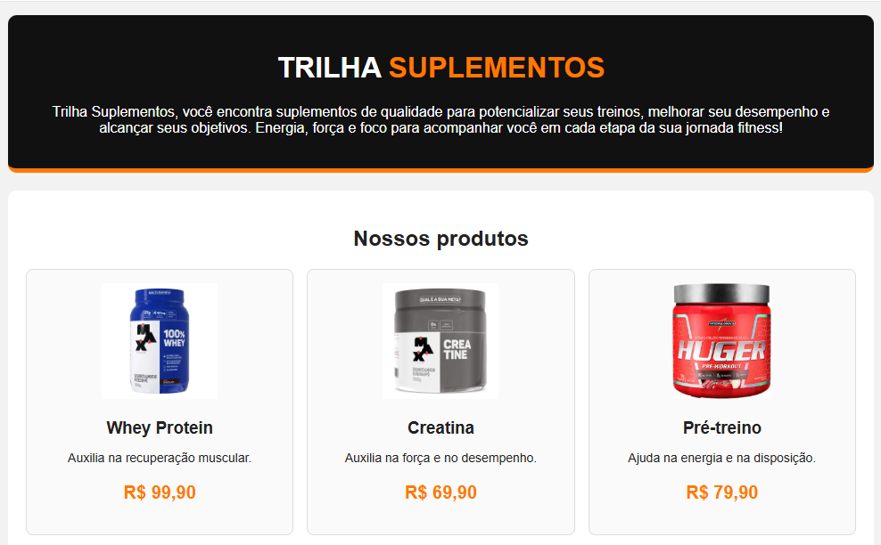
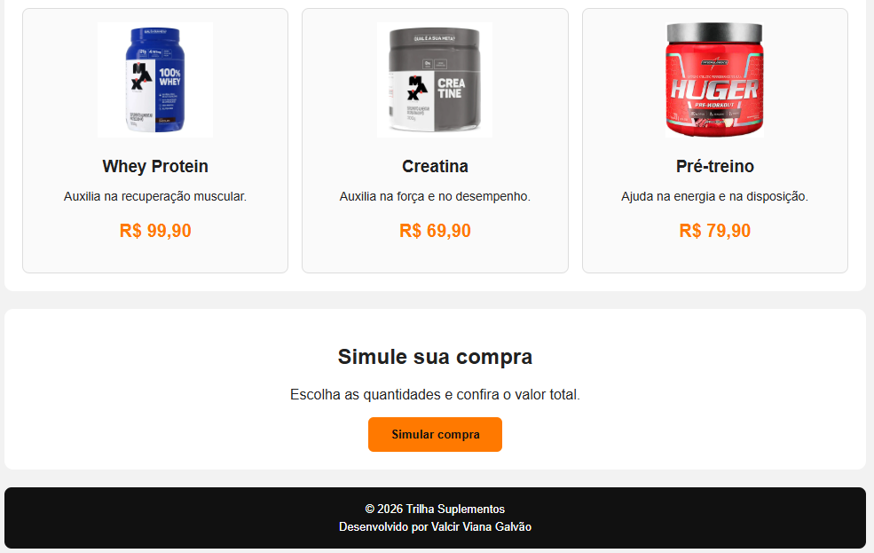

# Desafio_01_trilha

Uma loja de suplementos

Aluno: Valcir Viana Galvão
Trilha: Desenvolvimento mobile
Projeto: Loja virtual de suplementos

Apresentação do projeto

O desafio 01 trilha é uma página web desenvolvida para apresentar produtos de suplementação alimentar. O projeto permite visualizar os produtos, consultar seus preços e simular uma compra informando as quantidades desejadas.

Produtos e preços

Produto

Preço

Whey Protein

R$ 99,90

Creatina

R$ 69,90

Pré-treino

R$ 79,90

Tecnologias utilizadas

HTML5: estrutura da página.

CSS3: cores, layout, espaçamentos e responsividade.

JavaScript: interação com o usuário e simulação de compra.

Como executar o projeto

Baixe ou clone os arquivos do projeto.

Abra a pasta no Visual Studio Code.

Verifique se os arquivos index.html, style.css e script.js estão na pasta principal.

Confira se as imagens estão na pasta imagens.

Abra o arquivo index.html no navegador. Você também pode utilizar a extensão Live Server do VS Code.

Captura de tela

Testes realizados

Verificação da exibição dos produtos e dos preços.

Verificação do carregamento das imagens.

Teste do botão Simular compra.

Verificação do cálculo do total conforme as quantidades informadas.

Verificação do layout em diferentes larguras de tela.

Dificuldade encontrada e aprendizado

Uma das dificuldades encontradas foi organizar os elementos da página e ajustar o cabeçalho para manter uma aparência proporcional às outras seções.

Durante o desenvolvimento, aprendi a estruturar uma página com HTML, aplicar estilos com CSS e utilizar JavaScript para criar interações. Também aprendi a organizar melhor o código e a ajustar o layout para diferentes tamanhos de tela.

Adaptei o código ao meu projeto, mantendo os três produtos, seus preços, as imagens, o botão de simulação de compra e o rodapé com meu nome. Também escolhi as cores preto, branco e laranja e ajustei a organização dos produtos para melhorar a visualização em computadores e celulares.

Verifiquei a página no navegador, conferindo a exibição dos produtos, os preços, as imagens, o layout e o botão Simular compra. Também testei diferentes quantidades para conferir se o cálculo do total estava correto.

Aprendi a organizar melhor o HTML, utilizar classes CSS para estilizar os elementos, criar layouts com CSS Grid e adaptar a página para diferentes tamanhos de tela. Também compreendi que a IA pode ajudar no desenvolvimento, mas é importante revisar o código, entender como ele funciona e testar as alterações.
Autor

Desenvolvido por Valcir Viana Galvão.
